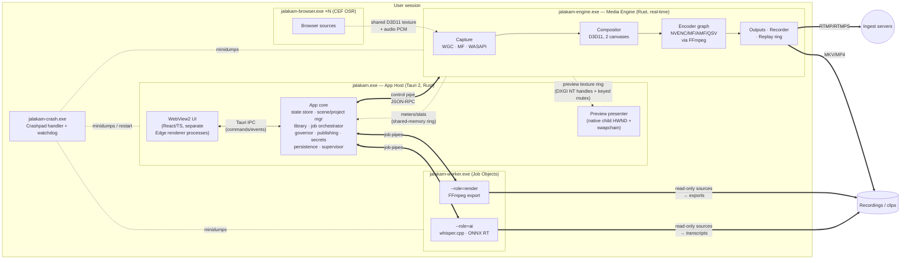
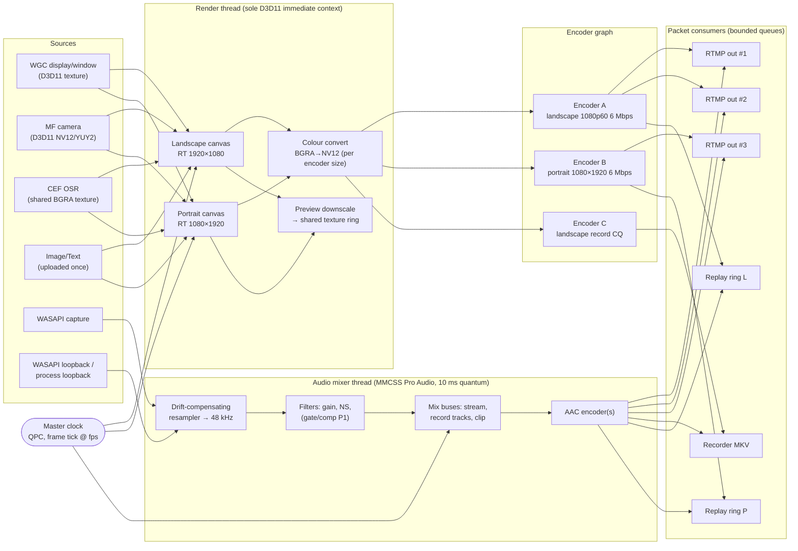
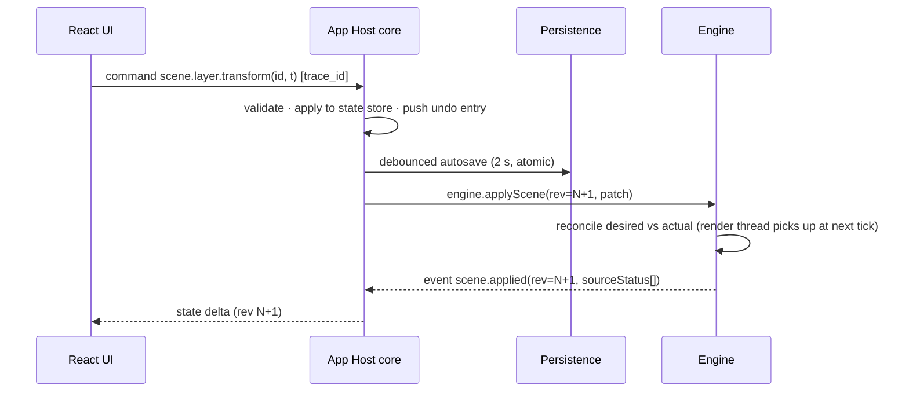
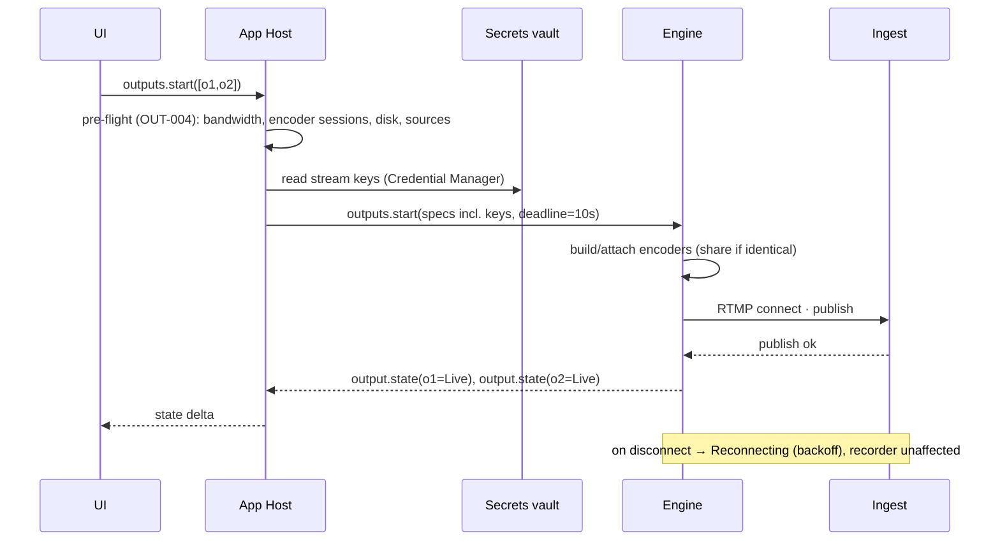
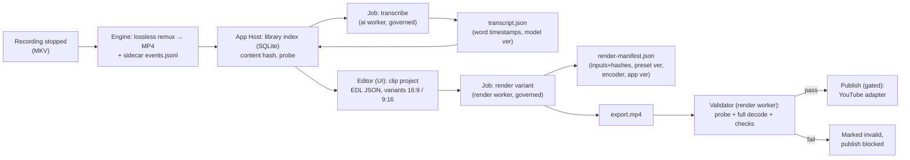
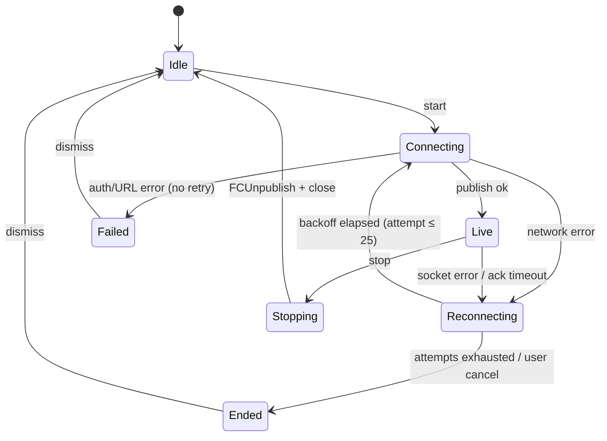

# System Design

Status: Accepted for M0 (pending POC-1 validation of the items marked **POC**). Inputs: `docs/product/*`, ADR 0001, and ADR-0002…ADR-0016 in `decisions/`.

## 1. Goals that shape the design

1. **The live output is sacred.** Nothing (UI, AI, rendering, browser content, disk, network on another output) may stall the frame clock or the encoders (NFR-PERF-01, NFR-REL-03, AI-007).
2. **Media stays on the GPU** from capture to encoder (VID-002).
3. **Every failure is local.** A failing source, output, worker or UI stops only itself.
4. **State is durable and recoverable.** It is persisted transactionally; source media is never modified (SYS-001/002, TL-003).
5. **Exports are reproducible** from a manifest (EXP-003, ADR-0013).

## 2. Process architecture

Five process roles (ADR-0005). Each arrow is a versioned IPC channel (ADR-0008).

| Process | Owns | Priority / limits | Lifetime |
|---|---|---|---|
| **App Host** `jalakam.exe` | UI, app state store, scene/project source of truth, persistence, library, job orchestration, resource governor, publishing adapters, secrets vault access, supervision of engine and workers | Normal priority | Session. Restarted by the watchdog on crash; reattaches to a running engine |
| **Media Engine** `jalakam-engine.exe` | Capture, audio mix, compositor, preview producer, encoder graph, outputs, recorder, replay ring | `ABOVE_NORMAL_PRIORITY_CLASS`; MMCSS on real-time threads; `IDXGIDevice::SetGPUThreadPriority(+7)` (max) **POC** | Started by App Host. **Survives App Host loss** for a grace period (default 10 min, configurable) while outputs or recordings are active, then stops cleanly and finalises files |
| **Browser** `jalakam-browser.exe` | CEF off-screen rendering for browser sources; one CEF browser per source; CEF's own renderer/GPU subprocesses | Normal; CEF sandbox on | Children of the engine (engine's Job Object, kill-on-close) |
| **Worker** `jalakam-worker.exe --role=ai\|render` | One job at a time: ASR, scoring features, detection (Labs), export rendering, thumbnails/proxies | `BELOW_NORMAL`/`IDLE` priority class; Job Object CPU-rate and memory caps; GPU thread priority lowest | Spawned per job class by App Host (App Host's Job Object, kill-on-close). Killable at any time |
| **Crash/watchdog** `jalakam-crash.exe` | Crashpad handler for all processes; relaunches App Host after an abnormal exit | Normal | Started first; exits last |

## 3. Streaming pipeline

Key properties (detail in ADR-0014 and `performance-budgets.md`):
- **One clock.** QPC drives the frame tick (high-resolution waitable timer). Video frames carry their capture QPC timestamp (WGC `SystemRelativeTime`, MF sample time mapped to QPC). Audio devices are resampled to the master clock with drift compensation. PTS = ticks since session start (VID-010).
- **The render thread never waits on a consumer.** Sources publish their latest frame (latest-wins mailbox). The compositor samples whatever is current at the tick. A missing frame reuses the previous one; it never blocks.
- **Encoder sharing.** Encoders are keyed by (canvas, size, fps, codec, rate control, bitrate, keyint, preset, profile). Outputs, recorder and replay rings subscribe to an encoder's packet stream (OUT-002).
- **Per-consumer bounded queues** with a drop policy: on overflow, drop non-reference frames, then everything up to the next IDR. This is counted as network-dropped. It never back-pressures the encoder (ADR-0014).
- **Replay ring** holds encoded packets indexed by IDR. A save copies packets from the first IDR at or before (now − N) into an MP4 mux on a background thread. There is no re-encode (LIB-003/004).

## 4. Major data flows

### 4.1 Control: user action → engine

### 4.2 Go-live

### 4.3 Post-session: recording → transcript → clip → export

## 5. Lifecycle management

### 5.1 Application start and stop
1. `jalakam.exe` starts the crash handler, then loads prefs (with migration snapshot, SYS-010). It probes for an existing engine via its named pipe. If one is found (App Host restart after a crash), it reattaches and requests a full state snapshot. Otherwise it spawns the engine.
2. The engine performs the device probe (ONB-002) and reports capabilities. The App Host sends the desired scene state (rev 1).
3. The UI loads, subscribes to state, and shows the preview once the first preview frame arrives.
4. Shutdown: the UI requests stop. If outputs or recordings are active, the user confirms. The App Host stops outputs (FCUnpublish) and finalises recordings (remux), waits for the engine's `stopped` event (deadline 15 s; then kill and recover on next launch), drains or pauses jobs (persisting their state), flushes the DB, and exits.

### 5.2 Component state machines (all components)
`Created → Starting → Running ⇄ Degraded → Stopping → Stopped`, plus `Failed(reason)`. Every transition is emitted as an event with a reason code. `Degraded` means it is working with reduced function (for example a source placeholder or an output reconnecting).

### 5.3 Output state machine (VID-004/005)

### 5.4 Job state machine (render queue and AI jobs)
`Queued → Running → (Paused ⇄ Running) → Succeeded | Failed(retryable?) | Cancelled`. State is persisted in SQLite on every transition. Jobs checkpoint at chunk boundaries (ASR: 30 s audio windows; render: none in release one, so it restarts from the beginning, AC-EXP-01).

## 6. Thread model

| Process | Thread | Role | Scheduling |
|---|---|---|---|
| Engine | `clock` | High-resolution waitable timer; posts ticks | MMCSS "Capture", time-critical |
| Engine | `render` | Sole owner of the D3D11 immediate context; composites canvases, colour converts, preview downscale | MMCSS "Capture" |
| Engine | `cap-*` | One per WGC/MF source; publishes latest frame to a mailbox | Above normal |
| Engine | `audio-in-*` | One per WASAPI endpoint, event-driven | MMCSS "Pro Audio" |
| Engine | `mixer` | 10 ms quantum mix, filters, AAC encode submit | MMCSS "Pro Audio" |
| Engine | `enc-*` | One per encoder session: submit frame / receive packets | Above normal |
| Engine | `out-*`, `rec`, `replay-save` | Network IO, muxing, file IO | Normal |
| Engine | `ctl` (tokio, 2 threads) | IPC, state reconciliation planning, stats | Normal |
| App Host | Tauri main + tokio pool | UI IPC, orchestration, persistence, adapters | Normal |
| App Host | `preview` | Waits on the preview texture keyed mutex; copies to the child swapchain; presents | Above normal |
| Worker | job threads | Bounded by Job Object CPU rate | Below normal / idle |

Rules:
1. Real-time threads (`clock`, `render`, `audio-*`, `mixer`, `enc-*`) never allocate on the hot path after warm-up, never take a lock held by non-real-time code, never do file or network IO, and never block on IPC.
2. Cross-thread handoff uses lock-free single-producer/single-consumer rings or latest-value mailboxes.
3. No async runtime on real-time threads.

## 7. Event delivery
- **Engine → App Host:** ordered event stream on the control pipe, with a monotonically increasing `seq`. The App Host detects gaps and requests a snapshot. High-rate data (audio meters at 30 Hz, stats at 1 Hz) goes over a shared-memory ring, not the pipe.
- **App Host → UI:** Tauri events carry *state deltas* stamped with a store revision. The UI applies deltas to a client store. Meters are throttled to 30 Hz and stats to 1 Hz. UI commands return typed results.
- **Delivery guarantees:** state events are at-least-once with revision-based deduplication. Meters are lossy (latest wins).

## 8. Cancellation
- Every long operation takes a `CancellationToken` (tokio-util) scoped to its owner: an output start, a job, a probe, an upload.
- Engine operations accept a deadline. On expiry they move to `Failed(timeout)` and release resources.
- Jobs: the App Host sends `job.cancel`. The worker must acknowledge within 2 s at the next chunk boundary. Otherwise the App Host terminates the worker's Job Object (all of its processes) and marks the job `Cancelled`. Partial outputs go to a temp path and are deleted.
- Uploads are cancellable. A resumable session is abandoned server-side by policy.

## 9. Error propagation
- Each boundary has a typed error enum (`thiserror`). Errors cross IPC as `{code, severity, message, context, retryable, trace_id}`.
- `code` is stable and namespaced (for example `OUT.RTMP.AUTH_REJECTED`, `CAP.WGC.ITEM_CLOSED`, `JOB.AI.MODEL_CHECKSUM`). The UI maps codes to user text and actions. Support uses codes to search logs.
- Panics: the engine catches unwinds at module boundaries (per source, per output, per encoder). A panic there marks the component `Failed`, logs it, writes a minidump, and lets the rest continue. A panic on `render`, `clock` or `mixer` is fatal: crash dump, then the App Host restarts the engine and offers recovery. Workers use `panic=abort`; the App Host sees the exit and fails the job.

## 10. Resource cleanup
- RAII everywhere (`Drop`). COM objects are released by `windows-rs` reference counting. FFmpeg contexts are wrapped in owning types.
- Child processes live in Job Objects with `JOB_OBJECT_LIMIT_KILL_ON_JOB_CLOSE`: workers in the App Host's job, CEF in the engine's job. The engine is **not** in the App Host's kill-on-close job, so it can outlive a host crash (§5.1).
- GPU resources are tracked per source/encoder with byte accounting (VRAM budget, `performance-budgets.md`). Release is verified in the soak test (NFR-REL-01).
- Files: temp files go in a per-session temp directory and are swept on start. Partial exports and uploads are cleaned on cancel or fail.

## 11. How the design meets the Phase 2 reliability requirements

| Requirement | Mechanism | ADR |
|---|---|---|
| Avoid starving real-time capture and encoding while AI runs | Separate worker processes with lower process and GPU priority; MMCSS real-time threads in the engine; a governor that throttles or pauses jobs on engine health signals; CPU-only AI while live | ADR-0005, ADR-0011 |
| Bound CPU, GPU and memory of background work | Job Object CPU-rate caps and memory limits per worker; VRAM budget check (`IDXGIAdapter3::QueryVideoMemoryInfo`) before GPU use; one job per worker role; chunked processing | ADR-0011 |
| Recover from output disconnections | Output state machine, exponential backoff with jitter, ≤ 25 attempts, recorder/replay independent, FCUnpublish on clean stop | ADR-0014 |
| Never block the UI on media operations | All media work in the engine or workers; the App Host runs IPC and persistence on async tasks; the UI only sends commands and receives deltas; preview presenting on its own thread | ADR-0005, ADR-0008 |
| Persist project and job state safely | SQLite WAL transactions for jobs/library/publish; atomic replace (temp → flush → `MoveFileEx(REPLACE_EXISTING\|WRITE_THROUGH)`) with 10-version history for documents; migration snapshots | ADR-0012 |
| Avoid destructive edits | Source media opened read-only by workers; edits are an EDL; derived data in a content-addressed cache; the hash is checked before render | ADR-0013 |
| Deterministic, repeatable exports | Render manifest (input hashes, EDL rev, preset version, encoder and settings, app/FFmpeg versions); fixed timebase; defined determinism levels L1–L3 with tests | ADR-0013 |
